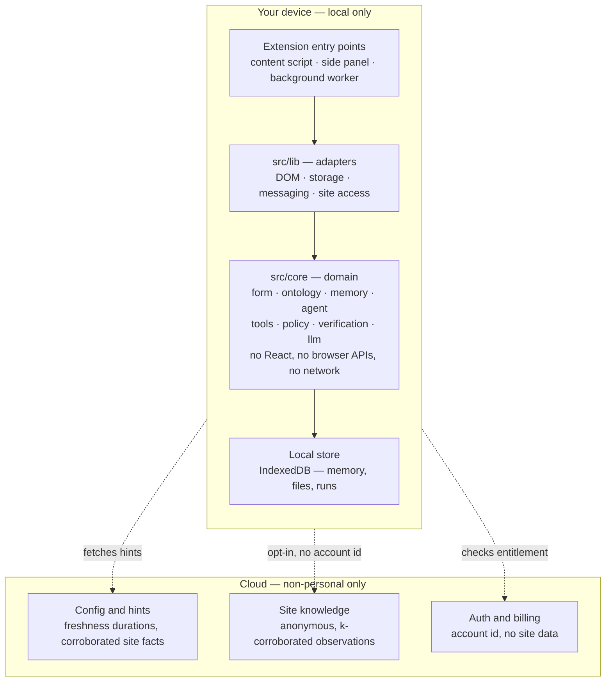

# Fill My Form

A privacy-first browser extension that understands web forms and helps you fill
them from a persistent personal memory.

**Your personal information stays on your device.** That is not a policy
statement — it is enforced by lint rules that fail CI. See
[docs/privacy.md](./docs/privacy.md).

> **Status: foundation.** The architecture, boundaries and quality gates are in
> place. Form detection, memory, retrieval and the agent loop are not yet
> implemented; each has a module with a documented contract and a README saying
> what lands there next.

## Quick start

```bash
bun install
cp .env.example .env
bun dev
```

`.env` can stay empty — every integration is optional and the extension is
useful with none of them configured.

`bun dev` opens Chrome with the extension loaded. Pin it to the toolbar once
and click the icon: that opens the side panel. The dev profile lives in
`.chrome-profile/` (gitignored) and is kept between runs, so the pin and any
site access you grant survive a restart. Delete that directory to start clean.

Chrome will not let an extension open its own side panel without a user
gesture, so the first click is always yours.

Only one browser can use a profile at a time. If a dev browser is already
open, repeating `bun dev` keeps that existing session; `bun dev:fresh` skips
the shared profile entirely.

Requires [Bun](https://bun.sh/) and Node 24+.

## Commands

| Command | What it does |
|---|---|
| `bun dev` | Chrome, with hot reload (`bun dev:firefox` for Firefox) |
| `bun dev:fresh` | The same, on a throwaway profile — for a second window or a clean slate |
| `bun dev:site` | Serves the local form fixtures at <http://localhost:4173> |
| `bun lint` | Format, lint, import order **and the `src/core` import boundaries** |
| `bun lint:fix` | The same, applying fixes |
| `bun typecheck` | `tsc --noEmit` |
| `bun test` | Unit tests (`bun test:watch` to iterate) |
| `bun test:e2e` | Builds the extension and smoke-tests it in real Chromium |
| `bun check` | Lint, typecheck and unit tests — the full local gate |
| `bun run build` | Production build + zips for Chrome and Firefox |

## Repository structure

```
src/
  core/          Domain layer. No React, no browser APIs, no cloud, no LLM SDK.
    form/          FormIR — what a form and its fields are
    ontology/      Canonical concepts and their aliases, as data
    memory/        Personal memory types and the MemoryStore contract
    agent/         Phases, statuses, events, the transition table
    tools/         Tool contracts, registry, validated execution path
    llm/           The LLMProvider port, a mock, and the AI SDK adapter
    policy/        What the runtime is willing to do automatically
    verification/  Comparing intent against reality
    errors.ts      Error taxonomy
    logging.ts     Structured logging with a closed field allowlist
    tests/         Unit tests — plain Bun, no DOM, no network

  app/           WXT entrypoints: background, content, popup, sidepanel, ...
  components/    React UI
  lib/           Browser and cloud adapters — storage, messaging, site access
  types/         Shared enums

test-site/       Local form fixtures. Tests never touch a third-party site.
scripts/         Fixture server, bundled-secret scanner
docs/            Architecture, agent, memory, privacy, testing, ADRs
```

Every directory under `src/core` has a `README.md` describing its contract and
what belongs in it. Start with [`src/core/README.md`](./src/core/README.md).

## Architecture



Every arrow is device-initiated: the extension makes the calls, nothing reaches
in. Config and hints come *down* and are non-personal — freshness durations and
corroborated facts about public web pages, identical for every user. What goes
*up* is the part to watch.

The cloud row is unbuilt. When it lands, the two upward channels must never be
joined — an origin plus an account identifier is a browsing history. See
[ADR 007](./docs/adr/007-shared-site-knowledge.md).

Dependencies point inward. `src/core` knows nothing about React, the extension
APIs, Supabase, OpenPanel or any model SDK — enforced by `noRestrictedImports`
overrides in `biome.json`, so a violation fails `bun lint` and CI. The payoff is
that the entire domain layer runs under plain `bun test` with no DOM, no
extension host and no network.

Four ideas carry most of the weight:

**The model is untrusted input.** It proposes actions; the runtime decides
whether they are allowed and executes them. Model output is parsed before use,
never executed, and never rendered as HTML.

**Progressive disclosure.** The agent does not receive every tool, all of
memory, or the whole page. It gets the minimum context for its current phase and
requests more only when it needs it.

**Deterministic first.** Exact alias matching runs before heuristics, which run
before retrieval, which runs before any model. `bun test` already proves that
"10th Passing Year" resolves to `education.secondary.completion_year` with no
LLM involved.

**Never guess.** Every answer is `known`, `unknown`, `ambiguous` or
`requires_confirmation`. There is no fifth value meaning "invented something
plausible".

More in [docs/architecture.md](./docs/architecture.md) and
[docs/agent.md](./docs/agent.md).

## Privacy model

| Local-only, always | Cloud-eligible |
|---|---|
| Personal memory | Authentication |
| Personal files, photos, signatures | Subscription and billing |
| Form values | Anonymous usage metadata |
| Page content | Non-sensitive diagnostics |
| Agent context containing personal data | Shared, non-personal website mappings |

The extension requests **no site access at install time**. It ships with
`activeTab` plus an empty host-permission list; access to a site is granted by
the user, one origin at a time, and the content script is registered for that
origin only (`src/lib/site-access.ts`).

Full detail, including how each rule is enforced, in
[docs/privacy.md](./docs/privacy.md).

## Environment variables

Everything in `.env` is compiled into the extension and is **public**. Server
secrets (`OPENAI_API_KEY`, `STRIPE_SECRET_KEY`, `SUPABASE_SERVICE_ROLE_KEY`)
belong to a backend, never here. CI runs `scripts/check-bundle-secrets.ts`
against the build output as a backstop.

| Variable | Required | Purpose |
|---|---|---|
| `VITE_APP_ENV` | no | `development` \| `test` \| `production` |
| `VITE_SUPABASE_URL` | no | Auth. Omit to run fully local and anonymous. |
| `VITE_SUPABASE_ANON_KEY` | no | Auth. |
| `VITE_OPEN_PANEL_KEY` | no | Anonymous analytics. Omit and none are sent. |

Validated by `env.config.ts` at startup; a malformed value fails loudly rather
than defaulting silently.

## How to add a tool

Tools are the only way the agent touches the world. Register one and the agent
loop does not change:

```ts
registry.register({
  name: "inspect_field_context",
  domain: CapabilityDomain.BROWSER,
  description: "Return labels and nearby text for one field.",
  input: z.object({ fieldId: z.string() }),
  output: z.object({ label: z.string().optional(), nearbyText: z.array(z.string()) }),
  risk: ActionRisk.LOW,
  execute: async ({ fieldId }, ctx) => adapter.describeField(fieldId, ctx.signal),
});
```

Arguments are parsed against `input` before execution and results against
`output` afterwards. The tool reaches a prompt only when its domain is in the
current phase's grant. Details in
[`src/core/tools/README.md`](./src/core/tools/README.md).

## How to add an LLM provider

Implement `LLMProvider` and wire it at composition time:

```ts
export class MyProvider implements LLMProvider {
  readonly id = "my-provider";
  async generate<T>(request: LLMRequest<T>): Promise<LLMResponse<T>> { /* ... */ }
}
```

Nothing in the agent changes. For anything OpenAI-compatible you probably do not
need a new provider — pass a different `LanguageModel` to `AiSdkProvider`.
Details in [`src/core/llm/README.md`](./src/core/llm/README.md) and
[ADR 002](./docs/adr/002-llm-port-over-vercel-ai-sdk.md).

## How to add an ontology concept

Append to `src/core/ontology/concepts.json`:

```json
{
  "key": "identity.nationality",
  "label": "Nationality",
  "sensitivity": "sensitive",
  "expects": "text",
  "aliases": { "en": ["nationality", "citizenship"], "hi": ["राष्ट्रीयता"] }
}
```

No code changes. The file is schema-validated at import, so a malformed entry
fails in tests rather than degrading at runtime. `sensitivity` drives policy —
choose it carefully. Details in
[`src/core/ontology/README.md`](./src/core/ontology/README.md).

## Testing

`bun test` runs the domain layer in plain Bun — no DOM, no extension host, no
network, so the suite finishes in well under a second.

`bun test:e2e` builds the extension and loads it into real Chromium. Ten smoke
tests, about twelve seconds, headless. They guard what unit tests structurally
cannot: that the built artefact loads, that its pages render, and that the
manifest still grants no site access. Screenshots and traces are captured on
failure; there is no pixel comparison yet, and
[docs/testing.md](./docs/testing.md) explains why.

`test-site/` holds local fixtures — a clean form, a messy one with no labels and
ambiguous names, and a dynamic one that injects fields after load — so automated
tests never depend on a third-party website.

## CI

`.github/workflows/tests.yml` runs two jobs on every pull request.

**Quality** — lint (including the import boundaries), typecheck, unit tests,
build, and a scan of the build output for secret-shaped strings.

**End-to-end** — installs Chromium and runs the smoke tests. Kept separate so a
lint failure surfaces in seconds rather than waiting on a browser.

Any failure blocks the merge.

`bun check` runs the same gates locally. A pre-commit hook runs the fast subset
(lint-fix and typecheck); tests are left to CI so committing stays quick.

## Documentation

- [architecture.md](./docs/architecture.md) — layers, boundaries, why
- [agent.md](./docs/agent.md) — the state machine and progressive disclosure
- [memory.md](./docs/memory.md) — provenance, freshness, why the model cannot write
- [privacy.md](./docs/privacy.md) — the data boundary and how it is enforced
- [learning.md](./docs/learning.md) — diagnosing failures, multilingual coverage, what we track
- [monetization.md](./docs/monetization.md) — the entitlement boundary, and what stays free
- [testing.md](./docs/testing.md) — what to test where
- [contributing.md](./docs/contributing.md) — conventions
- [adr/](./docs/adr/) — decisions and their consequences
- [roadmap/](./docs/roadmap/) — the phased path to release, one brief per phase

## Credits

Built on [Extro](https://github.com/turbostarter/extro) by Bartosz Zagrodzki
(MIT). WXT, React, Tailwind, Biome and the extension plumbing come from there;
`src/core`, the privacy boundary and the agent architecture are ours. See
[`docs/adr/001-single-package-over-monorepo.md`](./docs/adr/001-single-package-over-monorepo.md)
for what was kept and what was changed.
