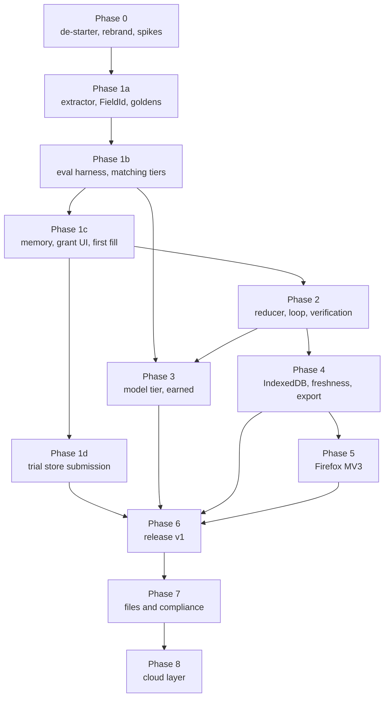

# Roadmap

The path from "well-shaped contracts that have never filled a field" to a Chrome and
Firefox release. Each phase is a self-contained brief that can be handed to one agent.

**Every agent reads [`_context.md`](./_context.md) first, then its own brief.**

## Dependency tree



The spine is `0 → 1a → 1b → 1c → 2`. Everything else hangs off it. `1d` runs in parallel
with `2` — it is mostly waiting on other people.

## Phases

| # | Brief | Delivers | Depth |
|---|---|---|---|
| 0 | [phase-0-destarter.md](./phase-0-destarter.md) | Starter code gone, product branding, three spikes answered, release track opened | Full |
| 1a | [phase-1a-extractor.md](./phase-1a-extractor.md) | DOM → `FormIR`, the `FieldId` scheme, committed goldens, `controlled.html` | Full |
| 1b | [phase-1b-matching.md](./phase-1b-matching.md) | Eval harness, then the deterministic matching tiers, then ontology growth | Full |
| 1c | [phase-1c-first-fill.md](./phase-1c-first-fill.md) | In-memory store, onboarding, the grant UI, and a real confirmed fill | Full |
| 1d | [phase-1d-trial-submission.md](./phase-1d-trial-submission.md) | An unlisted submission to both stores, to buy information | Full |
| 2 | [phase-2-agent-loop.md](./phase-2-agent-loop.md) | The reducer, the loop, the `Verifier`, service-worker resumability | Full |
| 3 | [phase-3-model-tier.md](./phase-3-model-tier.md) | A model tier, only for the measured residual | Outline |
| 4 | [phase-4-persistence.md](./phase-4-persistence.md) | IndexedDB, freshness, export and wipe | Outline |
| 5 | [phase-5-firefox.md](./phase-5-firefox.md) | Firefox on MV3 | Outline |
| 6 | [phase-6-release.md](./phase-6-release.md) | The real release pipeline and v1 in both stores | Outline |
| 7 | [phase-7-files.md](./phase-7-files.md) | File references and pixel-level compliance | Sketch |
| 8 | [phase-8-cloud.md](./phase-8-cloud.md) | Entitlement, then shared site knowledge | Sketch |

**Depth is deliberate.** Phases 0–2 are written to be executed now; their unknowns are
resolved. Phases 3–6 are outlines whose detail depends on what earlier phases measure — a
model tier specified before the eval exists is a guess. Phases 7–8 are sketches. **Expand a
brief before handing it over**, using what the preceding phases actually found. Writing
exhaustive detail for Phase 7 today would be a spec wearing the wrong hat.

## Handoff protocol

**What an agent receives:** `_context.md`, its own brief, and the repo. Nothing else.

**What an agent returns** — a handback with these five sections:

1. **Done** — deliverables completed, with file paths.
2. **Gate output** — the actual terminal output of every command in the brief's gate. Not a
   summary. If a gate did not run, say so and why.
3. **Decisions** — anything the brief left open that you closed, and the reasoning. These
   feed the next phase's brief.
4. **Escalations** — non-negotiables you nearly broke, contradictions found, defects spotted
   outside scope. Report, do not silently fix.
5. **Divergences** — where you did something other than what the brief said, and why.

**Definition of done for every phase, without exception:**

```bash
bun check        # lint + typecheck + unit tests
bun run build    # both browser targets
```

Both green, plus the phase's own gate. A phase that leaves `main` red is not done.

## Rules for the orchestrator

- **One phase at a time on the spine.** `1a` invalidates goldens; `1b` depends on them; `1c`
  depends on the matcher. Parallelising the spine means redoing work.
- **`1d` can run in parallel with `2`** and should — store review latency is not your time.
- **Re-read the brief after each handback.** Decisions recorded in section 3 usually change
  the next brief. Update it before handing it over.
- **Do not let a phase widen its own gate.** If an agent reports a gate cannot pass, that is
  an escalation to you, not a licence to relax it.
- **Commit between phases.** Each phase should land as its own reviewable change.

## Current status

Nothing started. The repo is at the end of the foundation stage: contracts written, quality
gates in place, 16 files of ADRs and doc updates uncommitted at the time of writing.

Phase 0 is unblocked.
